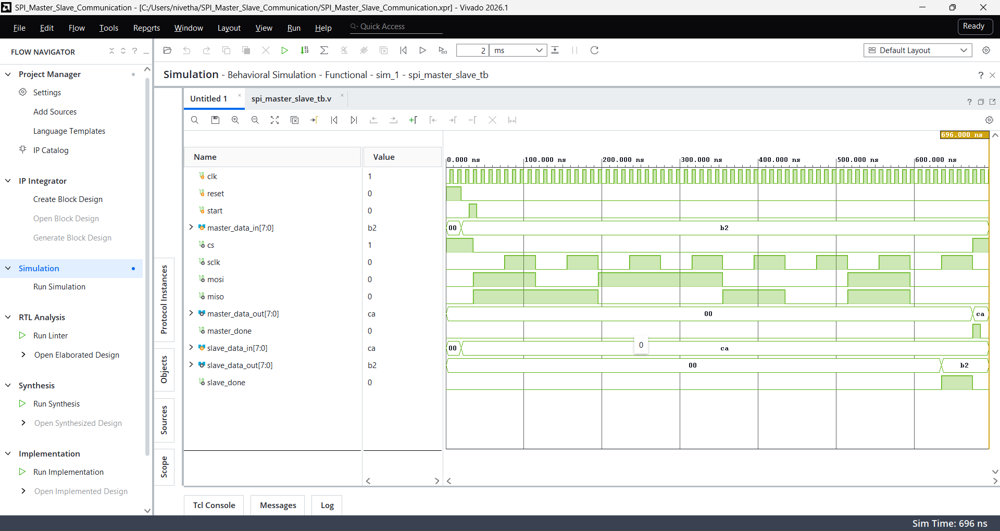
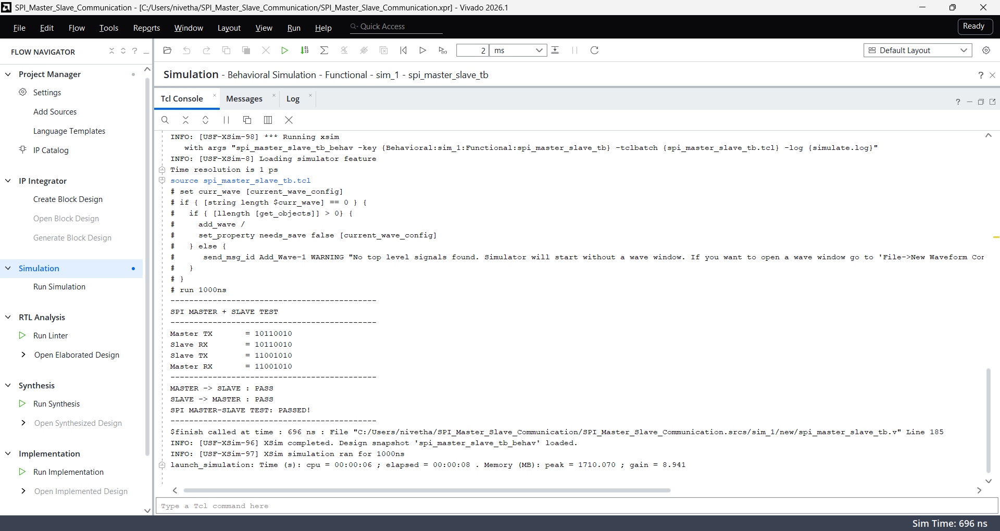

# SPI Master-Slave Communication

## Description
Verilog implementation of SPI Master-Slave communication using SPI Mode 0 (CPOL = 0, CPHA = 0).

## Features
- 8-bit data transfer
- Full-duplex communication
- MSB-first transmission
- Master-generated SCLK
- Chip Select control
- MOSI and MISO communication

## Architecture

```text
             SPI Master                  SPI Slave

MOSI  ------------------------------->  MOSI
MISO  <-------------------------------  MISO
SCLK  ------------------------------->  SCLK
CS    --------------------------------> CS
```

## Test Results

| Parameter | Data |
|---|---|
| Master transmits | `10110010` |
| Slave receives | `10110010` |
| Slave transmits | `11001010` |
| Master receives | `11001010` |

## Simulation

The design was verified using behavioral simulation in Xilinx Vivado 2026.1.

- Master-to-slave communication: PASS
- Slave-to-master communication: PASS
- Full-duplex communication: PASS

## Screenshots

### Simulation Waveform


### Simulation Output


## Result

SPI Master-Slave communication was successfully verified through behavioral simulation.
